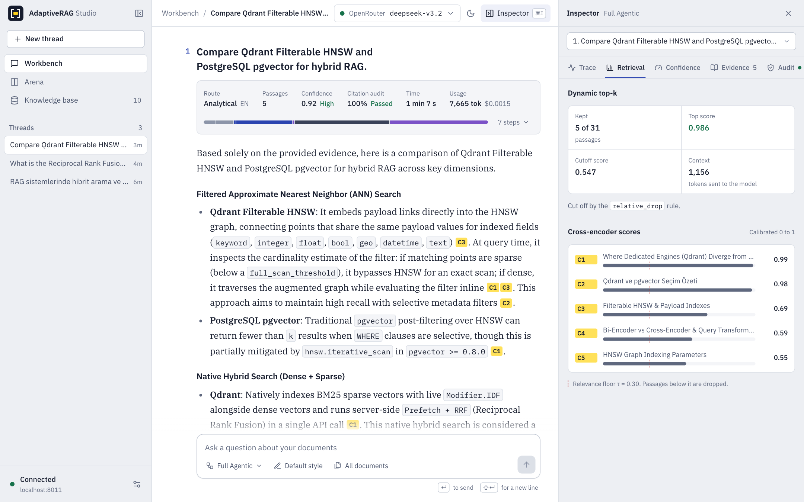
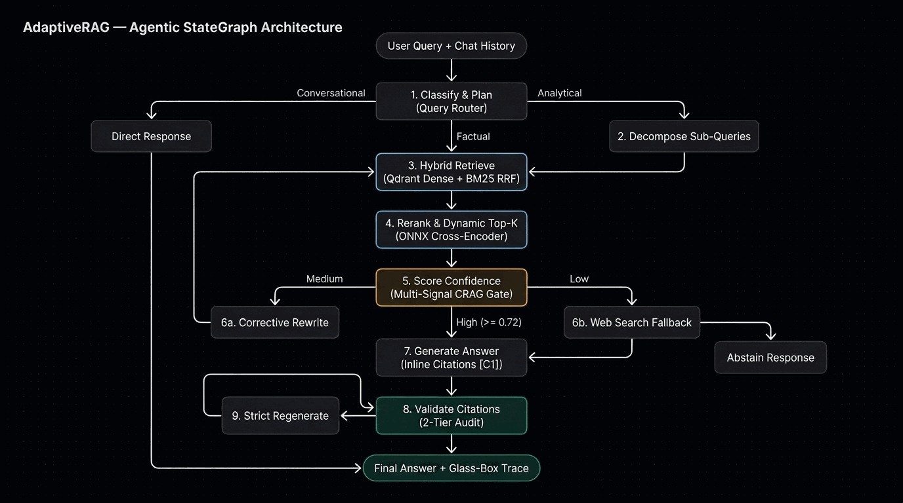
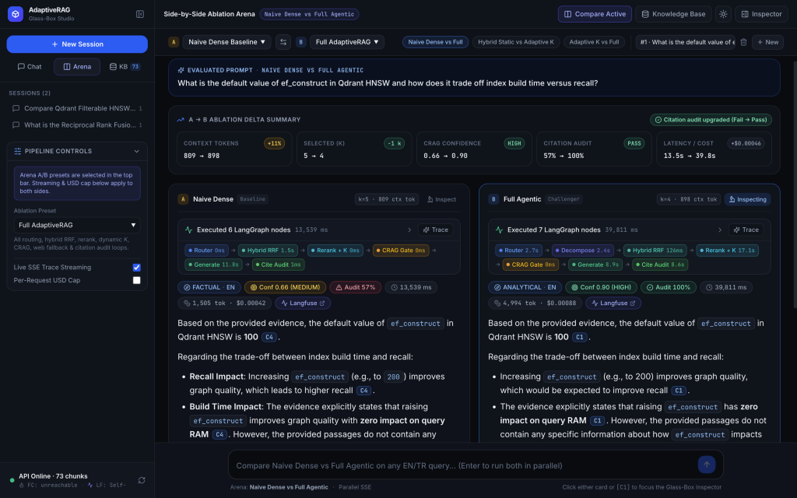
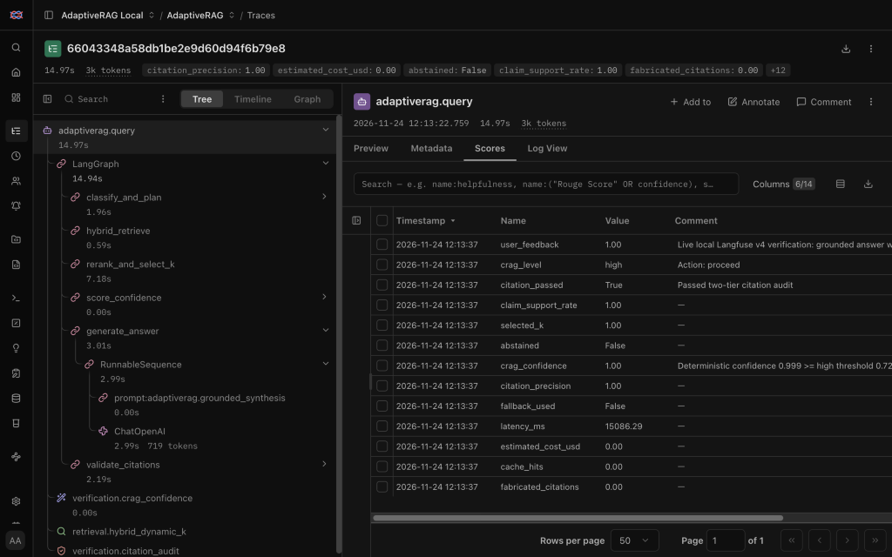
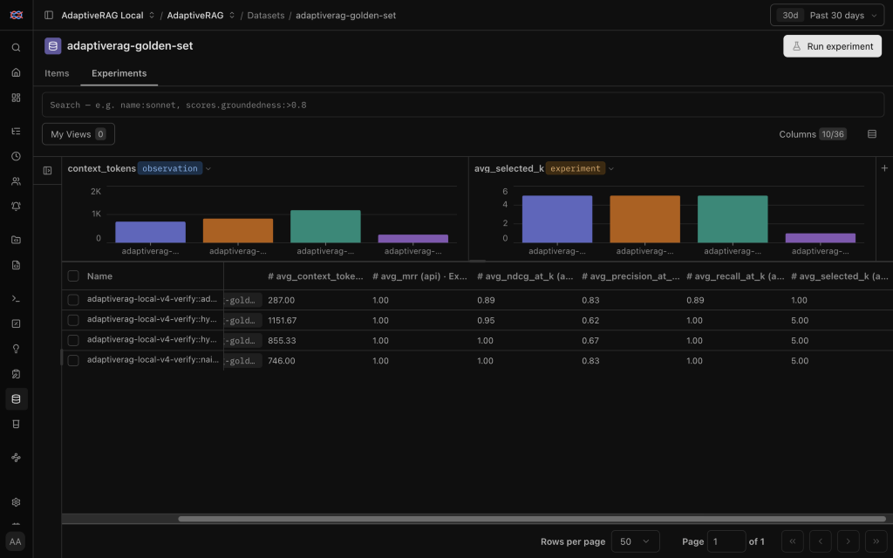

<div align="center">

# AdaptiveRAG

**Query-aware Agentic RAG engine with verifiable citations and glass-box observability.**  
Native Qdrant Hybrid Search (Dense + BM25 RRF), local ONNX Cross-Encoder reranking, 3-stage Dynamic Top-K, CRAG confidence gating, Langfuse v5 OTEL, and multilingual/cross-lingual (`EN ↔ TR`) evaluation.

[](https://github.com/emirhansilsupur/adaptive-rag/actions/workflows/ci.yml)


-10B981)
[](LICENSE)

[**Architecture**](#architecture) · [**Studio & Arena**](#glass-box-studio--ablation-arena) · [**Benchmarks**](#empirical-benchmarks) · [**Quickstart**](#quickstart) · [**Security & Deploy**](#production-deployment--guardrails) · [**Observability**](#observability--prompt-management) · [**API & Structure**](#api--project-structure)

</div>

<br />

<p align="center">
  <picture>
    <source media="(prefers-color-scheme: dark)" srcset="docs/assets/studio-glass-box-dark.png" />
    
  </picture>
</p>
<p align="center">
  <sub><strong>React 19 Glass-Box Studio:</strong> a 7-step analytical run with its receipt (<code>CRAG 0.92 High</code>, <code>Audit 100% Passed</code>, <code>1 min 7 s</code>, <code>$0.0015</code>), proportional node latency strip, serif answer with highlighter <code>[C1]</code>–<code>[C5]</code> citation marks, and the Retrieval inspector showing the calibrated Cross-Encoder Dynamic Top-K cutoff (<code>5 of 31</code> passages via <code>relative_drop</code>, top score <code>0.986</code>, <code>τ = 0.30</code> floor).</sub>
</p>

| Retrieval Quality (`$0` ONNX) | Context Efficiency | Grounded Synthesis (RAGAS) | Safety & Unit Economics |
| :---: | :---: | :---: | :---: |
| **`0.989` MRR · `97.1%` Recall**<br><sub>Hybrid RRF + `bge-reranker-v2-m3` (`66` TR/EN queries)</sub> | **`-68.3%` Context Tokens**<br><sub>`1,093 → 347` tok via Dynamic Top-K (`1.000` factual MRR)</sub> | **`0.994` Faithfulness**<br><sub>`0.993` Ctx Precision · `100%` Tier-2 claim support</sub> | **`100%` Out-of-Corpus Gated**<br><sub>`$0.0005–$0.0008`/query · `271` `$0` CI tests</sub> |

---

## Why AdaptiveRAG?

Static, single-path RAG pipelines fail in production along three predictable axes:

1. **Over-Retrieval on Conversational & Simple Lookups:** Greetings and single-parameter questions pay the same retrieval, reranking, and prompt-token tax as complex synthesis tasks.
2. **Under-Retrieval on Multi-Hop Comparisons:** Single-query dense search with a fixed `top_k=5` misses exact technical identifiers (`ef_construct`, `Modifier.IDF`, `max_num_batched_tokens`) and drops cross-document evidence.
3. **Silent Hallucination on Stale or Out-of-Corpus Queries:** When local retrieval returns weak passages, naive pipelines still generate fluent, uncited, or fabricated answers.

**AdaptiveRAG** pairs deterministic Information Retrieval with a **bounded cyclic LangGraph state machine**—routing each query along its minimal sufficient path while streaming every internal decision to a Glass-Box engineering workbench.

---

## Architecture

<p align="center">
  
</p>
<p align="center">
  <sub><strong>Bounded Cyclic Agentic StateGraph:</strong> Query-complexity routing (<code>conversational</code> fast-path, single-query <code>factual</code>, decomposed <code>analytical</code>), Qdrant Dense + BM25 RRF retrieval, ONNX Cross-Encoder Dynamic Top-K, multi-signal CRAG gating with bounded rewrite/web fallback, and Two-Tier Citation Auditing.</sub>
</p>

### Core Engineering Pillars

| Pillar | Mechanism | Production Payoff |
| :--- | :--- | :--- |
| **1. Query Routing & Strategy Matrix** | Structured `QueryPlan` routes to `conversational`, `factual` (`k=2..5`), or `analytical` (`2–4` sub-queries, `k=4..10`) via [`configs/strategies.yaml`](configs/strategies.yaml). | Zero retrieval tax on chat turns; multi-hop decomposition only when needed. |
| **2. Native Qdrant Hybrid Search** | Single collection with Named Vectors: multilingual dense (`768d`) + `Qdrant/bm25` (`Modifier.IDF`), parallel `Prefetch`, and server-side RRF fusion. Every point records the models that embedded it, so after a model swap the collection is refused (`HTTP 409`) until it's re-indexed. | Captures both multilingual/cross-lingual paraphrases and exact symbols; a model swap can't silently return unrelated passages. |
| **3. Local ONNX Cross-Encoder** | Quantized `BAAI/bge-reranker-v2-m3-int8` (100+ languages) with sigmoid calibration `σ(z) ∈ [0, 1]`, offloaded via `asyncio.to_thread`. | `$0` API reranking without blocking the FastAPI async event loop. |
| **4. Dynamic Top-K & Parent-Child** | 3-stage cutoff (`τ_min` floor, relative drop & elbow gap, token budget) + opt-in **Small-to-Big** (`≤256`-tok children → deduplicated `≤1000`-tok parents). | `-68.3%` context tokens on flat chunks; `+9.7 pp` analytical fact coverage with Parent-Child. |
| **5. Multi-Signal CRAG Gate** | Deterministic composite score auto-passes `HIGH (≥ 0.72)` and auto-routes `LOW (< 0.38)` at `$0`; calls CRAG LLM grader *only* inside `[0.38, 0.72)`. | Eliminates redundant grader calls on clear hits and obvious misses. |
| **6. Web Fallback & Abstention** | `FallbackRetriever` (**Tavily** primary → **DuckDuckGo** zero-key backup) yielding `[W1]..[Wn]` chunks, or language-matched abstention. | Prevents fabrication on fresh or out-of-domain queries (`100%` OOC caught). |
| **7. Two-Tier Citation Audit** | **Tier-1 (`0 ms`, `$0`):** Regex check for phantom IDs & uncited claims. **Tier-2:** Claim entailment (`SUPPORTED` / `CONTRADICTED`) + max `1` `regenerate_strict` pass. Fails closed: if the judge errors, the answer is reported `Unverified`, never `Passed`. | Enforces verifiable `[Cn]` / `[Wn]` grounding (`100%` citation precision). |
| **8. FinOps & Langfuse v5 OTEL** | Tiered routing (`qwen3-30b-a3b` + `deepseek-v3.2`), WAL `SQLiteLLMCache`, isolated per-request `CostTracker` (`HTTP 402`) that a request can tighten but never loosen, `$0` pricing for local models, and versioned Prompt Management. | Predictable sub-millicent query cost with full trace-to-prompt lineage. |
| **9. Adaptive 2-Tier PDF & OCR** | `LiteParse` Rust/PDFium layout Markdown (`~3 ms/page`, `$0`) → Tier-1 process-isolated `OCRia-nano-1` ONNX + `TableNet` (`$0`) → Tier-2 multimodal `Vision-LLM` fallback. | Preserves `#` headings, `\|...\|` tables, and `EN`/`TR` diacritics across digital & scanned PDFs without PyTorch bloat. |
| **10. Multi-Layer Guardrails** | Local-only mode until `API_AUTH_KEY` is set, constant-time key check, per-IP rate limiter, `$0` EN/TR injection & PII screening, `<evidence>` isolation, and fail-closed async SSRF/path sandboxing. | Hardened single-container deployment serving FastAPI + React SPA on port `8000`. |

<details>
<summary><strong>Mathematical Formulation (3-Stage Dynamic Top-K &amp; Multi-Signal Confidence)</strong></summary>

<br />

- **Calibrated Cross-Encoder Probability:** Raw logits $z_i$ from `bge-reranker-v2-m3-int8` are mapped via a numerically stable sigmoid $\sigma(z_i) = (1 + e^{-z_i})^{-1} \in [0, 1]$.
- **3-Stage Dynamic Top-K Cutoff:** Given sorted scores $s_1 \ge s_2 \ge \dots \ge s_N$:
  1. *Relevance Floor:* Retain candidates satisfying $s_i \ge \tau_{\min}$ (returns $k=0$ immediately when $s_1 < \tau_{\min}$).
  2. *Relative Drop & Score Elbow:* Retain while $s_i \ge \alpha \cdot s_1$ and $(s_{i-1} - s_i) \le \delta_{\text{gap}}$.
  3. *Strategy Bounds & Token Cap:* Clamp within `[rerank_min_k, rerank_max_k]` and `max_context_tokens` (preserving `6,000`-char parent excerpts when `enable_parent_child=true`).
- **Deterministic Pre-CRAG Confidence:**

$$C_{\text{det}} = 0.50\,S_{\text{top1}} + 0.30\,S_{\text{mean}} + 0.20\,S_{\text{cov}}$$

  Scores with $C_{\text{det}} \ge 0.72$ (`HIGH`) proceed directly to synthesis; $C_{\text{det}} < 0.38$ (`LOW`) route directly to rewrite/fallback; only $C_{\text{det}} \in [0.38, 0.72)$ invokes the LLM CRAG grader.

</details>

---

## Glass-Box Studio & Ablation Arena

The React 19 + TypeScript + Tailwind CSS v4 workbench (`make ui` on `:5173`, or served directly by FastAPI in production) exposes every retrieval, routing, and verification signal in real time. Its design system treats every answer as a document with receipts: `IBM Plex Sans` for the instrument, `IBM Plex Serif` for answers and source passages, `IBM Plex Mono` only for identifiers, ink-on-paper light and night-ink dark themes (following the OS preference), and a highlighter yellow reserved for citations and evidence.

- **Sidebar (Navigation, Threads & Connection):** View switcher (**`Workbench`**, **`Arena`**, **`Knowledge base`**), research threads saved in the browser's IndexedDB (a warning appears if the browser refuses a save) with two-step deletion, and a connection panel for the API endpoint, session `X-API-Key`, and live Qdrant/Firecrawl/Langfuse/Guardrails status.
- **Composer controls:** Pipeline preset picker next to the question box (`Full`, `Adaptive Routing`, `Hybrid + Rerank`, `Naive Dense`, or granular `Custom` switches including **`Parent-Child (Small→Big)`**), plus per-thread response style and document scope. The header **Runtime** popover holds provider/model/temperature, session BYOK keys, live step streaming, and the per-question spend cap.
- **Answers with receipts:** Each turn shows a run receipt (route, passages, CRAG confidence, citation audit, time, tokens and cost, `Langfuse ↗`) above a **proportional node latency strip**, a serif answer with highlighter `[C1]` / `[W1]` citation marks that preview the cited passage on hover, a sources row, copy, and **👍 / 👎 reviewer feedback** (`POST /v1/feedback`).
- **Resizable 5-Tab Inspector (`⌘I`):** Docked from `1280px`, a slide-over sheet on smaller screens.
  - **`Trace`:** Query plan ledger, decomposed sub-queries, labelled strategy parameters, and a true start-offset timeline of LangGraph nodes.
  - **`Retrieval`:** Dynamic top-k ledger (`Kept`, `Top score`, `Cutoff score`, `Context`), `Small→Big` expansion stats, and click-to-inspect cross-encoder score bars against the `τ` floor.
  - **`Confidence`:** Calibrated score on a gate scale with the `0.38` / `0.72` zones, grader verdict, and weighted signal breakdown.
  - **`Evidence`:** Documents/Web filter, parent-section lineage, source URLs, and a highlighter sweep on the passage a citation points to.
  - **`Audit`:** Tier-1 valid/phantom IDs, uncited sentence alerts, and Tier-2 claim entailment verdicts, with an `Unverified` warning when the judge fails to run.
- **Knowledge base & ingestion:** Drag-and-drop `.md`/`.txt`/`.pdf` uploads with **Adaptive 2-Tier PDF OCR** (`Auto`, `OCRia-nano`, `Vision LLM`, `Off`), 1-click `data/raw` re-index, **Firecrawl Local** page import and whole-site crawling, opt-in per-upload **`Parent-Child`** indexing (`256 → 1000` tok, always answered from the parent sections), and a searchable document inventory (`Small→Big` badges) with 2-step deletion.
- **Side-by-Side Ablation Arena:** Executes any two presets concurrently over SSE (`Promise.allSettled`), computing a live **`A → B` "What changed" scorecard** across context tokens, passages kept, CRAG confidence, citation audit (`Fail → Pass`), time, and cost.

<p align="center">
  <picture>
    <source media="(prefers-color-scheme: dark)" srcset="docs/assets/studio-compare-arena-dark.png" />
    
  </picture>
</p>
<p align="center">
  <sub><strong>Side-by-Side Ablation Arena:</strong> Parallel SSE run on the same question. <code>Naive Dense</code> (<code>k=5 · 809 tok</code>, <code>CRAG 0.66 Medium</code>) finds the <code>ef_construct</code> default only at <code>[C4]</code>; <code>Full Agentic</code> (<code>k=4 · 898 tok</code>, <code>CRAG 0.90 High</code>) reranks that passage to <code>[C1]</code> (relevance <code>0.99</code>). After one strict regeneration its Tier-2 audit still flags the single claim the corpus doesn't back (build-time impact), so both sides show <code>Flagged</code>.</sub>
</p>

---

## Empirical Benchmarks

While AdaptiveRAG ingests arbitrary `.md`, `.txt`, `.pdf`, and live web/docs corpora (plus external JSONL / HuggingFace QA suites such as HotpotQA and RAGBench), the repository ships with a reproducible **66-query multilingual benchmark** ([`data/eval/golden_set.jsonl`](data/eval/golden_set.jsonl): `40 EN + 26 TR`, including `EN ↔ TR` cross-lingual lookups) stratified across `factual` (`28`), `analytical` (`18`), `conversational` (`6`), `web_fallback` (`7`), and `unanswerable` (`7`) over 10 bundled reference documents in [`data/raw/`](data/raw/).

### 1. Offline 4-Way IR Ablation (`66` Queries, `$0.00` LLM Spend)

Measured locally with real FastEmbed ONNX weights (`paraphrase-multilingual-mpnet-base-v2`, `Qdrant/bm25` with `Modifier.IDF`, and `BAAI/bge-reranker-v2-m3-int8` on Apple Silicon CPU; run `offline_b5256ec3`):

| Config | Recall@k | Precision@k | MRR | NDCG@k | Avg `k` (Ctx Tok) | Out-of-Corpus Gate |
| :--- | :---: | :---: | :---: | :---: | :---: | :---: |
| `naive_dense` | 90.6% | 60.5% | 0.886 | 0.870 | 5.00 (`734` tok) | 0/14 (`0.0%`) |
| `hybrid_static` | 92.4% | 64.3% | 0.967 | 0.912 | 5.00 (`887` tok) | 0/14 (`0.0%`) |
| `hybrid_rerank` | **97.1%** | 62.7% | **0.989** | **0.958** | 5.00 (`1,093` tok) | 0/14 (`0.0%`) |
| `adaptive_dynamic_k` | 88.4% | **87.3%** | 0.946 | 0.891 | **1.53 (`347` tok)** | **14/14 (`100%` rec / `87.5%` prec)** |

- **Hybrid RRF + Multilingual Cross-Encoder:** Lifts overall MRR from `0.886` → **`0.989`** (`+0.103`) and Turkish factual MRR (incl. TR→EN cross-lingual) from `0.825` → **`1.000`**.
- **68.3% Leaner Context via Dynamic Top-K:** Raises Precision@k by **`+24.6 pp`** (`62.7% → 87.3%`) while cutting prompt context from `1,093` to **`347` tokens**—retaining **`100%` Recall, `1.000` MRR, and `1.000` NDCG** across all 28 `factual` queries at `Avg k = 1.39`.
- **Zero-LLM Out-of-Corpus Screening & Multi-Hop Trade-Off:** Stage-1 `τ_min` catches **`14/14` (`100%`)** `web_fallback` + `unanswerable` queries and skips `6/6` conversational turns at `$0` LLM cost. Single-query offline `analytical` recall drops (`92.6% → 70.4%`) when LLM sub-query decomposition is disabled, directly motivating the live agentic graph below.

<details>
<summary><strong>View Per-Stratum Breakdown, 4-Way Preset Matrix &amp; CPU Latency Details</strong></summary>

<br />

#### Per-Stratum & Cross-Lingual Slice (`offline_b5256ec3`)

| Stratum / Slice | `naive_dense` | `hybrid_static` | `hybrid_rerank` | `adaptive_dynamic_k` *(offline)* |
| :--- | :---: | :---: | :---: | :---: |
| **`factual` (28 EN+TR)** | 92.9% Rec · 0.848 MRR · `723` tok | 100% Rec · 0.946 MRR · `878` tok | **100% Rec · 1.000 MRR · `1,049` tok** | **100% Rec · 1.000 MRR · `k=1.39` (`340` tok, -67.6%)** |
| **`factual` TR (10, TR→EN)** | 100% Rec · 0.825 MRR · `k=5.00` | 100% Rec · 0.950 MRR · `k=5.00` | **100% Rec · 1.000 MRR** · `k=5.00` | **100% Rec · 1.000 MRR · `k=1.20`** |
| **`analytical` (18 multi-doc)** | 87.0% Rec · 0.944 MRR · `k=5.00` | 80.6% Rec · 1.000 MRR · `k=5.00` | **92.6% Rec · 0.972 MRR · 0.892 NDCG** | 70.4% Rec · 0.861 MRR · `k=3.44` (`744` tok) |
| **`conversational` (6)** | `k=5.00` (`1,342` wasted tok) | `k=5.00` (`1,256` wasted tok) | `k=5.00` (`1,328` wasted tok) | **`k=0.00` (`0` tok — 100% skipped)** |
| **`web_fallback` + `unanswerable` (14)** | `0/14` gated (`462–550` tok) | `0/14` gated (`710–793` tok) | `0/14` gated (`1,064–1,089` tok) | **`14/14` (100%) gated (`0` tok)** |

#### 4-Way Live Ablation Preset Matrix

| Preset | Retrieval | Routing & Multi-Query | Cross-Encoder | Dynamic Top-K | CRAG / Rewrite / Web Fallback / Tier-2 Audit |
| :--- | :---: | :---: | :---: | :---: | :---: |
| **`naive_dense`** | Dense only | Off | Off | Static (`k=5`) | Off *(Tier-1 citation telemetry only)* |
| **`hybrid_rerank`** | Dense + BM25 RRF | Off | On | Static (`k=5`) | Off *(Tier-1 citation telemetry only)* |
| **`adaptive_routing`** | Dense + BM25 RRF | On | On | 3-Stage Adaptive | Off *(Tier-1 citation telemetry only)* |
| **`full`** | Dense + BM25 RRF | On | On | 3-Stage Adaptive | **All Enabled** |

- **Latency Note (Apple Silicon CPU):** Native Qdrant Hybrid RRF runs in **`10.9 ms` p50 / `14.4 ms` p95** (`9.4 ms` dense-only). Scoring 20 candidates through CPU-only `bge-reranker-v2-m3-int8` takes `6.2 s` p50; enabling GPU/CoreML execution providers or lowering `fusion_limit` brings cross-encoder latency below `200 ms`.

</details>

### 2. Parent-Child (`256 → 1000` tok) vs. Flat (`512` tok) Chunking (`66` Queries, `$0.00` Spend)

Head-to-head comparison (`make eval-parent-child`, run `pc_ablation_154441cd`, `62` flat vs. `74` child chunks):

| Strategy & Config | Recall@k | Precision@k | MRR | Analytical Fact Cov | Avg `k` (Ctx Tok) | Cold Rerank p50 / p95 |
| :--- | :---: | :---: | :---: | :---: | :---: | :---: |
| `flat_hybrid_rerank` *(512)* | **97.1%** | 63.3% | **0.978** | 64.3% | 5.00 (`1,084` tok) | 5,250 / 6,180 ms |
| `parent_child_hybrid_rerank` *(256→1000)* | **97.1%** | **67.6%** (`+4.3 pp`) | **0.978** | **74.0%** (`+9.7 pp`) | 4.12 (`1,184` tok) | **4,211 / 4,847 ms** (`-19.8%`) |
| `flat_adaptive_dynamic_k` *(512)* | 88.4% | 87.3% | 0.946 | 54.5% | 1.51 (**`345` tok**) | — *(cached index pass)* |
| `parent_child_adaptive_dynamic_k` *(256→1000)* | **88.8%** | **89.1%** (`+1.8 pp`) | **0.967** | **62.4%** (`+7.9 pp`) | **1.38** (`411` tok) | — *(cached index pass)* |

- **Completeness & Cross-Lingual Rescue:** Expanding matched `≤256`-token child chunks into deduplicated `≤1000`-token H1/H2 parent sections lifts analytical key-fact coverage by **`+9.7 pp`** (static) and **`+7.9 pp`** (Dynamic Top-K, overall fact coverage `51.4% → 54.6%`, NDCG `0.891 → 0.900`), boosts Turkish Dynamic-K MRR (`0.882 → 0.941`), halves analytical false abstentions (`11.1% → 5.6%`, OOC gate precision `87.5% → 93.3%`), and speeds up cold CPU reranking by **`-19.8%`** at a modest `+66`-token trade-off (`ENABLE_PARENT_CHILD_RETRIEVAL=true`).

### 3. Live 4-Way Agentic + RAGAS Ablation (`20` Stratified Queries, Cold Uncached)

Executed end-to-end with `LLM_CACHE_ENABLED=false` across a proportional 20-query slice (`8` factual, `5` analytical, `2` conversational, `3` web-fallback, `2` unanswerable; `12 EN + 8 TR` covering `10/10` docs; run `live_980103d1`). Models: `qwen/qwen3-30b-a3b-instruct-2507` (router/CRAG + cross-family RAGAS v0.4.4 judge) and `deepseek/deepseek-v3.2` (synthesis/Tier-2 entailment). Total real OpenRouter spend: **`$0.04850`** across all 80 workflow runs + **`$0.10756`** for 52 RAGAS evaluations (**`$0.15606`** total).

| Preset | Recall@k | Precision@k | MRR / NDCG | Avg `k` (Ctx Tok) | OOC Caught | Workflow Cost (Total / Query) |
| :--- | :---: | :---: | :---: | :---: | :---: | :---: |
| `naive_dense` | 92.3% | 62.8% | 0.885 / 0.895 | 5.00 (`766` tok) | 0/5 (`0%`) | `$0.00983` (`$0.00049`/q) |
| `hybrid_rerank` | **97.4%** | 52.7% | **1.000 / 0.961** | 5.00 (`1,143` tok) | 0/5 (`0%`) | `$0.01243` (`$0.00062`/q) |
| `adaptive_routing` | 93.6% | 82.1% | **1.000** / 0.947 | **2.10 (`462` tok)** | 4/5 (`80%`) | `$0.01033` (**`$0.00052`/q**) |
| `full` | 89.7% | **84.0%** | **1.000** / 0.908 | 2.20 (`489` tok) | **5/5 (`100%`)** | `$0.01591` (`$0.00080`/q) |

| Preset | RAGAS Faithfulness | Answer Relevancy | Context Precision | Context Recall | Citation Audit (`13` Grounded Queries) |
| :--- | :---: | :---: | :---: | :---: | :---: |
| `naive_dense` | 0.876 | 0.783 | 0.612 | 0.731 | 100% ID prec · 65.3% Tier-1 line ratio |
| `hybrid_rerank` | 0.969 | 0.899 | 0.963 | 0.897 | 99.7% ID prec · 69.4% Tier-1 line ratio |
| `adaptive_routing` | **0.994** | **0.902** | **0.993** | **0.974** | **100%** ID prec · 73.3% Tier-1 line ratio |
| `full` | **0.988** | 0.866 | **0.991** | **0.949** | **100% ID prec · 100% Tier-2 entailment (13/13)** |

- **Higher RAGAS Quality *and* `-16.9%` Lower LLM Spend:** Against static `hybrid_rerank`, `adaptive_routing` lifts **Faithfulness** (`0.969 → 0.994`) and **Context Recall** (`0.897 → 0.974`) while cutting context tokens by **`-59.6%`** and total LLM spend from `$0.01243` to **`$0.01033`** (including `0`-token skip on `2/2` chat turns).
- **Corrective Rewrite Rescue & `100%` Out-of-Corpus Safety (`full`):** Bounded query rewriting rescued cross-lingual `anal_tr_01` (`50% → 100%` recall), while CRAG + fallback + honest abstention caught **`5/5` (`100%`)** out-of-corpus queries and achieved **`100%` Tier-2 claim support** (`0` phantom citations; `70%` strict 3-way router label match due to conservative promotion of multi-clause factual queries to `analytical`).

<details>
<summary><strong>Reproducible Benchmark CLI Commands</strong></summary>

```bash
# 1. Zero-API-cost 4-way offline IR ablation (in-memory Qdrant + local ONNX)
uv run python -m eval.run_benchmark --mode offline-ir --in-memory

# 2. Zero-API-cost Flat (512 tok) vs. Parent-Child (256->1000 tok) head-to-head ablation
make eval-parent-child

# 3. Cold 20-query proportional stratified live Agentic + RAGAS ablation
LLM_CACHE_ENABLED=false uv run python -m eval.run_benchmark --mode live --in-memory \
  --limit 20 --stratified --with-ragas --max-cost-usd 0.40 --output-dir eval/reports/live

# 4. External JSONL or HuggingFace QA dataset adapter (HotpotQA / RAGBench)
uv run python -m eval.run_benchmark --mode offline-ir --in-memory \
  --hf-dataset hotpot_qa --hf-subset distractor --limit 25
```

Each run emits `benchmark_report.json`, `benchmark_summary.md`, and an interactive Plotly `benchmark_chart.html` under `eval/reports/`.

</details>

---

## Quickstart

**Prerequisites:** Python **3.12+**, [`uv`](https://docs.astral.sh/uv/), Node.js **20+** (for local Studio dev), Docker, and an LLM API key ([OpenRouter](https://openrouter.ai/) by default; OpenAI, Gemini, Anthropic, and local Ollama are also supported).

```bash
# 1. Clone & install Python + React Studio dependencies
git clone https://github.com/emirhansilsupur/adaptive-rag.git
cd adaptive-rag
make install

# 2. Configure environment (set OPENROUTER_API_KEY in .env)
cp .env.example .env

# 3. Start Qdrant (:6333) & index the bundled sample corpus (or upload your own PDFs/URLs in Studio)
make up
make ingest
# Optional Small-to-Big indexing: uv run python -m adaptiverag.ingestion.indexer --parent-child --recreate

# 4. Run FastAPI (:8000) and React 19 Studio (:5173) in two terminals
make api
make ui
```

- **Studio UI:** `http://localhost:5173` *(optional legacy Streamlit inspector: `make ui-legacy` on `:8501`)*
- **OpenAPI Docs:** `http://localhost:8000/docs`
- **Local-only by default:** everything binds to `127.0.0.1`, and without `API_AUTH_KEY` the API answers only requests addressed to `localhost` from the Studio origin or non-browser tools. Set `API_AUTH_KEY` before running `make api API_HOST=0.0.0.0`.

---

## Production Deployment & Guardrails

The multi-stage [`Dockerfile`](Dockerfile) builds the React 19 SPA (`Stage 1`, same-origin `VITE_API_URL=""`) and serves both `/v1/*` endpoints and static UI assets from a hardened, non-root `python:3.12-slim` image on port `8000`:

```bash
# Launch Qdrant + single-container FastAPI/React Studio on http://localhost:8000
make up-prod

# Build standalone image (pass --build-arg PRELOAD_MODELS=true for air-gapped ONNX weights)
make docker-build
```

The image runs one API process (`--workers 1`), because the rate limiter and model caches live in memory. Writes to a collection take turns through a lock file (`~/.cache/adaptiverag/locks/<collection>.lock`): an upload, a delete or `make ingest` started by the same user on the same machine waits while another process replaces the collection, instead of writing into the copy about to be dropped.

| Security Layer | Key Environment Variables | Enforcement Behavior |
| :--- | :--- | :--- |
| **Local-Only Mode** | `CORS_ALLOW_ORIGINS`, `ALLOWED_HOSTS_WITHOUT_AUTH` | Active while `API_AUTH_KEY` is unset: only loopback `Host` headers (stops LAN clients and DNS rebinding) and allowed browser `Origin`s (stops cross-site multipart/form POSTs, which skip the CORS preflight) get through; others get `HTTP 403`. CORS never defaults to `*`, and Compose publishes every port on `127.0.0.1`. |
| **Session-Only Provider Keys** | `ALLOW_CLIENT_PROVIDER_KEYS` | A key sent in `X-Provider-API-Key` runs only that request: it never enters `Settings`, is cached under a SHA-256 fingerprint, and never becomes the server's default model. Without a server key, key-less queries get `HTTP 503` instead of someone else's key. |
| **API Authentication** | `API_AUTH_KEY` | Constant-time (`hmac.compare_digest`) `X-API-Key` / `Bearer` check on `/v1/*`; keeps `/v1/health` and SPA public; built-in Studio key prompt. |
| **Sliding-Window Rate Limit** | `RATE_LIMIT_ENABLED`, `RATE_LIMIT_REQUESTS_PER_MINUTE`, `RATE_LIMIT_TRUST_PROXY_HEADERS` | Thread-safe per-IP ASGI limiter returning `X-RateLimit-*` headers and `HTTP 429` (`Retry-After`) with zero SSE stream buffering. Counts live in the API process, so the image runs one (`--workers 1`, which also overrides `WEB_CONCURRENCY`); behind several replicas, rate-limit at the proxy. |
| **Prompt-Injection Defense** | `GUARDRAILS_ENABLED`, `GUARDRAILS_BLOCK_PROMPT_INJECTION` | `$0` NFKC/zero-width-normalized EN+TR override/jailbreak/exfiltration blocking (`HTTP 400`) + `sanitize_untrusted_passage` & `<evidence>` XML isolation. |
| **PII & Secret Protection** | `GUARDRAILS_PII_MODE=redact\|block\|off` | Checksum-aware redaction/blocking for API keys, emails, phone numbers, Luhn cards, and Turkish TCKN (`X-Guardrail-PII-Redacted`). |
| **Corpus & SSRF Sandbox** | `ALLOWED_CORPUS_ROOT`, `FIRECRAWL_ALLOW_PRIVATE_URLS` | Confines local `/v1/ingest` paths to `ALLOWED_CORPUS_ROOT` (`HTTP 403`) and enforces fail-closed async DNS + post-redirect SSRF validation (`HTTP 422`). |

---

## Observability & Prompt Management

AdaptiveRAG integrates a fail-open **Langfuse v5 OpenTelemetry** layer (`observability/tracing.py`, `observability/prompts.py`, `eval/langfuse_eval.py`) spanning four production loops:

1. **Deep OTEL Tracing & 13 Automated Online Scores:** Manual-lifecycle root `agent` spans (SSE-safe across async generators) capture LLM generations alongside custom `retriever` (Dynamic-K + Parent-Child), `span` (SQLite cache hits), `evaluator` (CRAG), and `guardrail` (Citation Audit) observations, publishing 13 online quality/cost scores plus `trace_url`.
2. **Human-in-the-Loop Feedback:** Studio 👍 / 👎 ratings (`POST /v1/feedback`) attach `user_feedback` directly to `trace_id` (falling back to structured logs when Langfuse is disabled).
3. **Datasets & Experiments Sync:** `make eval-langfuse` idempotently syncs `golden_set.jsonl` (UUIDv5 item IDs) and publishes multi-preset IR (`Recall`, `MRR`, `NDCG`, `fact_coverage`) and RAGAS scores as comparable Langfuse Experiments.
4. **Versioned Prompt Management:** All 8 canonical system prompts support label-based fetching (`LANGFUSE_PROMPT_LABEL=production`), TTL caching, native trace-to-prompt linking, automatic `SQLiteLLMCache` invalidation on version bumps, and zero-downtime local fallback.

<p align="center">
  
</p>
<p align="center">
  <sub><strong>Langfuse v4 OTEL Trace:</strong> Full LangGraph execution hierarchy, custom retrieval/verification spans, native versioned prompt link (<code>prompt:adaptiverag.grounded_synthesis</code>), and 12 automated scores + Studio <code>user_feedback</code>.</sub>
</p>

<details>
<summary><strong>View Langfuse Experiments Comparison, Self-Hosted v4 Stack &amp; CLI Commands</strong></summary>

<br />

<p align="center">
  
</p>
<p align="center">
  <sub><strong>4-Way Ablation Experiments (<code>adaptiverag-golden-set</code>):</strong> Synced via <code>make eval-langfuse</code>, showing <code>adaptive_dynamic_k</code> cutting average context tokens from <code>1,152</code> to <code>287</code> while preserving <code>1.00</code> MRR.</sub>
</p>

- **Cloud Free Tier (Zero Local Overhead):** Set `LANGFUSE_ENABLED=true`, `LANGFUSE_PUBLIC_KEY`, and `LANGFUSE_SECRET_KEY` in `.env` (`make up` runs only Qdrant).
- **Self-Hosted Langfuse v4 (`make up-full`):** Launches the `observability` Docker Compose profile (`PostgreSQL 16`, `ClickHouse 25.12`, `Redis 7`, `MinIO`, `langfuse-worker:4`, `langfuse:4`) with headless bootstrap at `http://localhost:3000`.

```bash
make prompts-list   # Inspect all 8 managed prompt templates & variables offline ($0)
make prompts-sync   # Idempotently seed/sync canonical prompts into Langfuse
make eval-langfuse  # Publish golden_set.jsonl + 4-way offline IR ablation to Experiments ($0)
```

</details>

---

## API & Project Structure

| Endpoint | Method | Purpose |
| :--- | :---: | :--- |
| `/v1/health` | `GET` | Non-crashing Qdrant, Firecrawl Local, Langfuse, PDF/OCR (`liteparse` / `ocria-nano`), security/guardrail, and model readiness telemetry, including the embedding models the collection was indexed with (`embedding_mismatch` after a model swap) |
| `/v1/documents` | `GET` | Every indexed document (`local`/`web`, `flat`/`parent_child`, chunks, tokens, URLs), read from one point per document instead of every chunk |
| `/v1/documents/{doc_id}` | `DELETE` | Remove all Qdrant points for `doc_id` and return updated collection count |
| `/v1/ingest` | `POST` | Zero-gap idempotent indexing of sandboxed `corpus_dir`, inline `documents`, `urls`, or `crawl_url` (`parent_child` & `ocr_mode` optional). `recreate_collection` builds a new collection behind a Qdrant alias and switches to it only once indexing succeeds, so a failure leaves the current one untouched |
| `/v1/ingest/upload` | `POST` | Multipart `.md` / `.txt` / `.pdf` upload with Adaptive 2-Tier OCR (`ocr_mode`), off-thread chunking, and crash-safe Qdrant upsert (same safe `recreate_collection` swap) |
| `/v1/query` | `POST` | Synchronous `FinalAnswer` JSON with isolated `max_cost_usd` cap (can only lower `MAX_RUN_COST_USD`), `trace_id`, and ablation overrides |
| `/v1/query/stream` | `POST` | SSE stream (`event: node_update` per LangGraph step → `event: final_answer`) |
| `/v1/feedback` | `POST` | Correlate human reviewer score (`0.0–1.0` + comment) to `trace_id` |

<details>
<summary><strong>REST, SSE &amp; Firecrawl Local Ingestion Examples</strong></summary>

```bash
# Synchronous query with preset & per-request USD cap
curl -s http://localhost:8000/v1/query \
  -H "Content-Type: application/json" \
  -d '{"query": "Compare Qdrant Filterable HNSW and PostgreSQL pgvector for hybrid RAG.", "preset": "full", "max_cost_usd": 0.05}' \
  | jq '{query_type, confidence: .confidence.level, k: (.evidence_chunks | length), citation_passed: .citation_report.passed, cost_usd: .usage.estimated_cost_usd}'

# Live SSE node-by-node trace stream (Turkish query -> English/Turkish hybrid retrieval)
curl -N http://localhost:8000/v1/query/stream \
  -H "Content-Type: application/json" \
  -d '{"query": "Qdrant ta ef_construct varsayilan degeri nedir?", "preset": "full"}'

# Optional $0 local web scraping & recursive docs crawling via firecrawl-local (:3002)
cargo install firecrawl-local && FIRECRAWL_CLOUD=off firecrawl-local serve
uv run python -m adaptiverag.ingestion.indexer \
  --crawl-url https://docs.qdrant.tech/concepts/ --crawl-limit 10 --crawl-max-depth 2
```

</details>

```text
adaptiverag/
├── .github/workflows/ci.yml   # GitHub Actions: ruff, mypy (src+eval), frontend tests/build, $0 pytest+cov
├── configs/strategies.yaml    # Declarative routing, dynamic-k, confidence & citation thresholds
├── data/
│   ├── raw/                   # Bundled 10-doc sample & benchmark corpus (8 EN + 2 TR)
│   └── eval/golden_set.jsonl  # 66-query stratified multilingual benchmark dataset
├── docs/assets/               # Architecture, Studio, Ablation Arena & Langfuse visuals
├── src/adaptiverag/
│   ├── schemas/               # Pydantic v2 contracts (query, retrieval, citation, response)
│   ├── llm/                   # Provider factory, structured output, WAL SQLite cache, CostTracker
│   ├── ingestion/             # LiteParse 2-Tier PDF/OCR parser, SSRF-safe Firecrawl client, flat & parent-child chunker, indexer
│   ├── retrieval/             # FastEmbed ONNX, Async Qdrant RRF, Cross-Encoder, Dynamic-K, Parent-Child, Web Fallback
│   ├── verification/          # Multi-signal Confidence + CRAG, Two-Tier Citation Audit, $0 Guardrails
│   ├── graph/                 # Bounded cyclic LangGraph StateGraph (12 async nodes, conditional edges, presets)
│   ├── observability/         # Structlog + Langfuse v5 OTEL tracing, online scoring & Prompt Management
│   └── api/                   # FastAPI lifespan, ASGI auth/rate-limit middleware, SPA serving, REST + SSE routes
├── frontend/                  # React 19 + TypeScript + Tailwind CSS v4 Glass-Box Studio & Ablation Arena
├── eval/                      # Offline IR + Parent-Child + Live/RAGAS + Langfuse Experiments runner
├── tests/                     # 151 deterministic $0 unit & in-memory Qdrant integration tests
├── Dockerfile                 # Multi-stage build (Node 22 SPA -> non-root Python 3.12 FastAPI runtime)
├── docker-compose.yml         # Qdrant + optional app (prod) & observability (Langfuse v4) profiles
└── LICENSE                    # MIT License
```

---

## Testing & Quality Gates

All `271` automated tests (`232` backend pytest + `39` frontend Vitest) run **100% offline at `$0` API cost** using deterministic ONNX/LLM stubs, `httpx.MockTransport`, in-memory Qdrant, and fake Langfuse clients:

```bash
make ci         # Full CI gate: ruff + mypy + frontend typecheck/vitest/build + offline pytest (84% cov)
make test       # 232 offline Python unit & in-memory Qdrant integration tests ($0)
make ui-test    # Frontend TypeScript check + 39 Vitest tests
make lint       # ruff check + ruff format --check
make typecheck  # mypy strict check across src/ and eval/
```

---

## License

Released under the [MIT License](LICENSE).
