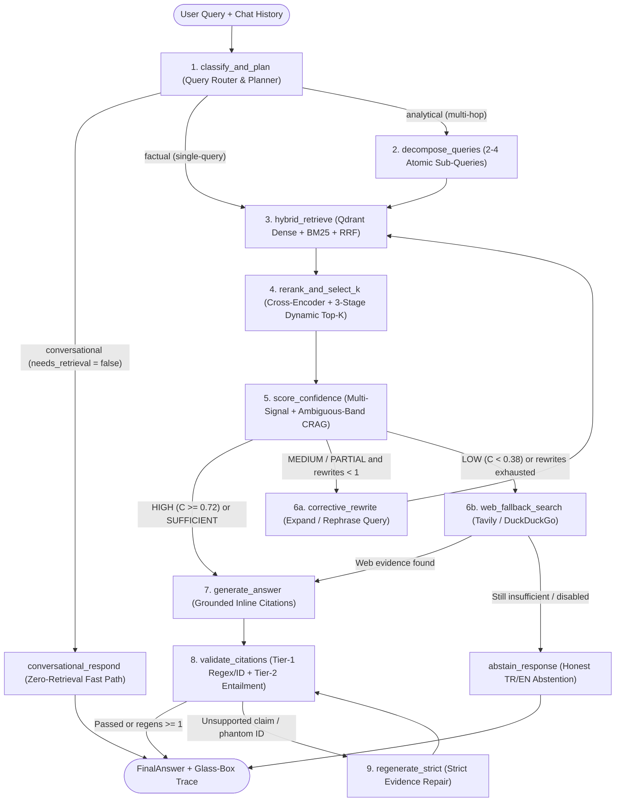

# AdaptiveRAG

> **Query-aware Agentic RAG engine** built with **LangGraph**, **Pydantic v2**, **Qdrant** (native Dense + BM25 Hybrid Search & RRF), local **FastEmbed ONNX** multilingual embeddings & cross-encoder reranking (**TR + EN**), 3-stage Dynamic Top-K selection, multi-signal CRAG confidence gating, web search fallback, two-tier citation validation, **Langfuse v5 OpenTelemetry Observability & Evaluation**, FastAPI SSE streaming, and a **React + TypeScript 3-Pane Glass-Box Studio**.

[](https://github.com/emirhansilsupur/Adaptive-RAG/actions/workflows/ci.yml)


---

## Why AdaptiveRAG?

Static ("one-size-fits-all") RAG pipelines fail in production along three predictable failure modes:

1. **Over-Retrieval on Simple / Conversational Turns:** Greetings, meta-instructions, and single-parameter lookups pay the same retrieval, reranking, and context-window tax as complex synthesis questions.
2. **Under-Retrieval on Analytical Comparisons:** Single-query dense search with a fixed `top_k=5` drops exact technical identifiers (e.g., `ef_construct`, `Modifier.IDF`, `max_num_batched_tokens`) and truncates cross-document trade-off evidence.
3. **Silent Hallucination & Stale Knowledge:** When local retrieval returns low-relevance passages—or the user asks for fresh/out-of-corpus information—naive pipelines still emit confident, uncited, or fabricated answers.

**AdaptiveRAG** combines deterministic Information Retrieval engineering with a **bounded cyclic LangGraph state machine** so every query dynamically selects its optimal path—and exposes every internal decision transparently over SSE and the Glass-Box UI.

---

## Architecture & Bounded Cyclic LangGraph Workflow



---

## Core Engineering Capabilities

| Pillar | Implementation Highlights |
| :--- | :--- |
| **1. Query Classification & Strategy Matrix** | Structured `QueryPlan` routes into `conversational` (zero retrieval), `factual` (sparse-leaning single-query, strict `k=2..5`), or `analytical` (2–4 concurrent sub-queries, permissive `k=4..10`). Tunable without code edits in [`configs/strategies.yaml`](configs/strategies.yaml). |
| **2. Native Qdrant Hybrid Search** | Single collection with Named Vectors: local multilingual dense (`sentence-transformers/paraphrase-multilingual-mpnet-base-v2`, 768d) + sparse lexical (`Qdrant/bm25`) with server-side `Modifier.IDF`, parallel `Prefetch`, and `FusionQuery(Fusion.RRF)`. |
| **3. Cross-Encoder Reranking (`$0` ONNX)** | Local `BAAI/bge-reranker-v2-m3-int8` (TR + EN cross-lingual support) with numerically stable sigmoid calibration $\sigma(z) \in [0, 1]$ and `asyncio.to_thread` offloading so the FastAPI event loop never blocks. |
| **4. 3-Stage Dynamic Top-K Cutoff** | Replaces static `top_k` with: **(1)** Relevance floor $s_i \ge \tau_{\min}$, **(2)** Relative drop & elbow gap $s_i \ge \alpha \cdot s_1 \land (s_{i-1} - s_i) \le \delta_{\text{gap}}$, and **(3)** `[rerank_min_k, rerank_max_k]` + `max_context_tokens` guard. |
| **5. Multi-Signal Confidence + CRAG** | Computes $C_{\text{det}} = 0.50\,S_{\text{top1}} + 0.30\,S_{\text{mean}} + 0.20\,S_{\text{cov}}$. Auto-passes `HIGH` ($\ge 0.72$) and auto-routes `LOW` ($< 0.38$) at `$0` LLM cost; invokes the lightweight CRAG grader *only* inside the ambiguous band $[0.38, 0.72)$. |
| **6. Web Search Fallback & Honest Abstention** | `FallbackRetriever` protocol backed by **Tavily** (primary) and **DuckDuckGo** (zero-key fallback), mapping web snippets into `[W1]..[Wn]` `EvidenceChunk`s. If local + web evidence still cannot ground the query, returns an honest TR/EN abstention. |
| **7. Two-Tier Citation Validation** | **Tier-1 (`0 ms`, `$0`):** Deterministic regex check catching phantom IDs (`[C9]`) and uncited factual sentences. **Tier-2:** Claim-level entailment (`SUPPORTED` / `PARTIALLY_SUPPORTED` / `UNSUPPORTED` / `CONTRADICTED`). Triggers at most 1 `regenerate_strict` repair pass when `claim_support_rate < 0.85`. |
| **8. Closed-Loop LLMOps & FinOps** | Tiered LLM routing (`qwen/qwen3-30b-a3b-instruct-2507` + `deepseek/deepseek-v3.2` via OpenRouter, swappable to OpenAI / Gemini / Anthropic / Ollama), local `SQLiteLLMCache`, hard `CostTracker` cap (`HTTP 402`), and **Langfuse v5 OTEL** deep tracing, automated online quality scoring, `POST /v1/feedback` human-in-the-loop loop, versioned **Prompt Management** (with zero-downtime local fallback), and Datasets & Experiments benchmark sync. |

---

## Quickstart

### 1. Prerequisites
- Python **3.12+** and [`uv`](https://docs.astral.sh/uv/)
- Docker & Docker Compose (for Qdrant and optional Langfuse observability)
- An LLM API key (defaults to [OpenRouter](https://openrouter.ai/) for low-cost tiered models; OpenAI, Gemini, Anthropic, and local Ollama are also supported)

### 2. Install Dependencies

```bash
git clone https://github.com/emirhansilsupur/Adaptive-RAG.git
cd Adaptive-RAG

# Installs core engine + Streamlit UI + RAGAS/eval + dev tools
make install
```

### 3. Configure Environment

```bash
cp .env.example .env
```

Edit `.env` and set your provider key (minimal configuration for OpenRouter):

```dotenv
LLM_PROVIDER=openrouter
OPENROUTER_API_KEY=sk-or-v1-...
LLM_FAST_MODEL=qwen/qwen3-30b-a3b-instruct-2507
LLM_GENERATION_MODEL=deepseek/deepseek-v3.2

# Optional: Tavily primary web fallback (DuckDuckGo works automatically without a key)
TAVILY_API_KEY=
WEB_FALLBACK_ENABLED=true

# FinOps budget & prompt cache guardrails
LLM_CACHE_ENABLED=true
MAX_RUN_COST_USD=0.50
```

### 4. Start Qdrant & Ingest the Multilingual Technical Corpus

The repository ships with **10 structure-aware technical Markdown documents** (8 EN + 2 TR covering Qdrant HNSW/Hybrid RRF, LangGraph, vLLM PagedAttention, FastAPI Async/SSE, PostgreSQL MVCC/`pgvector`, CRAG/Self-RAG, RAGAS/IR metrics, and TR+EN FinOps RAG patterns) in [`data/raw/`](data/raw/).

```bash
# Start Qdrant vector database (localhost:6333)
make up

# Optional: start Qdrant + Langfuse observability stack (localhost:3000)
# make up-full

# Chunk and idempotently index all documents (UUIDv5 chunk IDs -> zero duplicates on re-run)
make ingest
```

### 5. Launch FastAPI Backend & React Glass-Box Studio

In terminal 1:
```bash
make api
# FastAPI + OpenAPI docs available at http://localhost:8000/docs
```

In terminal 2:
```bash
make ui
# React + TypeScript Glass-Box Studio available at http://localhost:5173
# (Optional legacy Streamlit UI: `make ui-legacy` at http://localhost:8501)
```

---

## API & Live SSE Streaming

AdaptiveRAG exposes eight versioned REST/SSE endpoints:

| Endpoint | Method | Description |
| :--- | :---: | :--- |
| `/v1/health` | `GET` | Non-crashing Qdrant status, Firecrawl Local status, Langfuse observability status, LLM readiness, active models, and web fallback providers |
| `/v1/documents` | `GET` | List all indexed documents in Qdrant grouped by `doc_id` with source origin (`local` / `web`), chunk counts, token totals, and clickable URLs |
| `/v1/documents/{doc_id}` | `DELETE` | Delete all Qdrant chunks belonging to `doc_id` and return remaining collection points |
| `/v1/ingest` | `POST` | Idempotently index a local corpus directory (`corpus_dir`), inline documents (`documents`), live URLs (`urls`), or a full docs site crawl (`crawl_url`) via `firecrawl-local` |
| `/v1/ingest/upload` | `POST` | Multipart file upload for `.md`, `.markdown`, `.txt`, and `.pdf` documents with structure-aware chunking and idempotent Qdrant upsert |
| `/v1/query` | `POST` | Synchronous full `FinalAnswer` JSON (with `trace_id`, optional `trace_url`, `session_id`, ablation overrides, and `max_cost_usd` cap) |
| `/v1/query/stream` | `POST` | Server-Sent Events (`sse-starlette`) streaming `event: node_update` per LangGraph node followed by `event: final_answer` |
| `/v1/feedback` | `POST` | Record human-in-the-loop answer rating (`score` `0.0–1.0` + optional comment) correlated via `trace_id` and forwarded to Langfuse when enabled |

### Live URL & Documentation Site Indexing (`firecrawl-local`, `$0` Local Scraping)

AdaptiveRAG supports scraping individual public URLs or recursively crawling entire documentation sites into clean Markdown via [**Firecrawl Local**](https://docs.firecrawl.dev/quickstarts/firecrawl-local) (`firecrawl-local serve` on `http://localhost:3002`, zero Docker/Redis/cloud keys required). Every scraped page is validated against **SSRF guardrails** (blocking `localhost`, private/loopback/cloud-metadata IPs, and non-HTTP(S) schemes), assigned a deterministic URL-based `doc_id` for idempotent re-indexing, split by the structure-aware Markdown chunker, upserted into Qdrant Hybrid Search, and surfaced with clickable source links in the Glass-Box Evidence tab.

```bash
# 1. Install & start Firecrawl Local (one-time Rust binary, runs on localhost:3002)
cargo install firecrawl-local
FIRECRAWL_CLOUD=off firecrawl-local serve

# 2. Index specific public URL(s) via CLI
uv run python -m adaptiverag.ingestion.indexer \
  --url https://docs.qdrant.tech/concepts/hybrid-queries/ \
  --url https://docs.firecrawl.dev/quickstarts/firecrawl-local

# 3. Recursively crawl & index a documentation site via CLI
uv run python -m adaptiverag.ingestion.indexer \
  --crawl-url https://docs.qdrant.tech/concepts/ --crawl-limit 10 --crawl-max-depth 2

# 4. Or trigger live URL / docs crawl over REST API (or the Streamlit sidebar)
curl -s http://localhost:8000/v1/ingest \
  -H "Content-Type: application/json" \
  -d '{
    "crawl_url": "https://docs.qdrant.tech/concepts/",
    "crawl_limit": 8,
    "crawl_max_depth": 2
  }' | jq '{documents_processed, chunks_created, total_collection_points, source_urls}'
```

### Example: Synchronous Query with Ablation Preset

```bash
curl -s http://localhost:8000/v1/query \
  -H "Content-Type: application/json" \
  -d '{
    "query": "Compare Qdrant Filterable HNSW and PostgreSQL pgvector for hybrid RAG.",
    "preset": "full",
    "max_cost_usd": 0.05
  }' | jq '{query_type, confidence: .confidence.level, k: (.evidence_chunks | length), citation_passed: .citation_report.passed, cost_usd: .usage.estimated_cost_usd}'
```

### Example: Live SSE Pipeline Trace Stream

```bash
curl -N http://localhost:8000/v1/query/stream \
  -H "Content-Type: application/json" \
  -d '{
    "query": "Qdrant ta ef_construct varsayilan degeri nedir?",
    "preset": "full"
  }'
```

### Glass-Box Studio Workbench (`frontend/`, React + TypeScript + Vite + Tailwind CSS)
The primary 3-pane Glass-Box Studio (`make ui` at `http://localhost:5173`) provides a dark/light themed engineering workbench built directly over the FastAPI REST & SSE endpoints:
- **Left Rail (Sessions & Controls):** `localStorage`-persisted research sessions, instant `Workbench` / `Knowledge Base` switcher, live ablation preset selector (`Full`, `Adaptive Routing`, `Hybrid + Rerank`, `Naive Dense`, or granular `Custom` switches), per-request USD cost cap, and live API/Qdrant/Firecrawl health status.
- **Center Chat & Live LangGraph Stepper:** Real-time animated LangGraph node execution track over `/v1/query/stream` (with cancelable `AbortController`), KaTeX math + GitHub-flavored Markdown rendering, **clickable inline `[C1]` / `[W1]` citation pills** that immediately open and highlight the exact source chunk in the right Inspector, **👍 / 👎 human-in-the-loop feedback** with optional reviewer notes (`POST /v1/feedback`), and clickable **Langfuse Trace ↗** deep links when tracing is enabled.
- **Right Resizable Glass-Box Inspector (`⌘I`):**
  1. **Trace & Plan:** Query plan, sub-queries, strategy hyperparameters JSON, and proportional LangGraph Latency Waterfall.
  2. **Dynamic Top-K:** Interactive SVG rerank/fusion bar chart with $\tau_{\min}$ threshold indicator and click-to-jump bars.
  3. **Confidence & CRAG:** Semicircular confidence gauge, CRAG grade & action badges, and 5-signal breakdown ($S_{\text{top1}}$, $S_{\text{mean}}$, $S_{\text{cov}}$, $C_{\text{det}}$, final score).
  4. **Evidence Passages:** Local/Web filter, expandable passage cards with scores, section paths, clickable Firecrawl/Web URLs, and pulse-highlight on inline citation click.
  5. **Citation Audit:** Tier-1 valid/fabricated IDs, uncited sentence alerts, and Tier-2 semantic claim entailment cards with clickable cited IDs.
- **Knowledge Base & Ingestion Studio:** Drag-and-drop `.md`/`.txt`/`.pdf` file upload (`/v1/ingest/upload`), one-click local corpus re-indexing, live **Firecrawl Local** URL scraper & docs crawler, and a searchable/filterable table of all indexed Qdrant documents with safe 2-step deletion.

*(The legacy Streamlit inspector remains available as an optional Python fallback via `make ui-legacy` on port `8501`.)*

---

## Closed-Loop LLM Observability, Evaluation & Prompt Management (Langfuse v5 OTEL)

AdaptiveRAG ships with a vendor-neutral, fail-open **Langfuse v5 OpenTelemetry** observability, evaluation, and prompt management layer (`src/adaptiverag/observability/tracing.py` + `src/adaptiverag/observability/prompts.py` + `eval/langfuse_eval.py`) designed around four connected production loops:

1. **Online Deep Tracing & Automated Quality Scoring:**
   - Every `/v1/query` and `/v1/query/stream` request opens a manual-lifecycle root `agent` trace (safe across FastAPI async SSE generators without OTEL `contextvars` leaks), propagating `session_id`, `preset`, `ablation`, and `environment` tags.
   - Alongside LangChain LLM generation spans, AdaptiveRAG explicitly records **retrieval/Dynamic-K (`retriever`)**, **SQLite cache-hit (`span`)**, **CRAG confidence (`evaluator`)**, and **two-tier citation audit (`guardrail`)** child observations so non-LLM and cached steps are never blind spots.
   - Upon completion, AdaptiveRAG automatically publishes structured online scores (`crag_confidence`, `crag_level`, `citation_precision`, `claim_support_rate`, `citation_passed`, `fabricated_citations`, `selected_k`, `fallback_used`, `abstained`, `latency_ms`, `estimated_cost_usd`, `cache_hits`) and returns `trace_id` + `trace_url` on `FinalAnswer`.
2. **Human-in-the-Loop Feedback (`POST /v1/feedback` ↔ React Studio):**
   - Clicking **👍 / 👎 (+ optional reviewer note)** on any assistant answer sends `user_feedback` (`1.0` / `0.0`) attached to the exact `trace_id` (persisting to Langfuse when configured and logging cleanly via `structlog` even when Langfuse is off).
3. **Offline Datasets & Experiments Benchmark Sync (`eval/langfuse_eval.py`):**
   - Passing `--langfuse-sync` to `eval/run_benchmark.py` idempotently upserts `data/eval/golden_set.jsonl` into a **Langfuse Dataset** (deterministic UUIDv5 item IDs) and publishes all 4 ablation configs + **IR** + **RAGAS** scores as comparable **Langfuse Experiments** at `$0` extra LLM cost.
4. **Versioned Prompt Management with Zero-Downtime Local Fallback (`src/adaptiverag/observability/prompts.py`):**
   - All **8 LLM system prompts** (`adaptiverag.router`, `decompose`, `corrective_rewrite`, `crag_grader`, `conversational`, `grounded_synthesis`, `strict_regeneration`, `citation_entailment`) are registered with mustache `{{variable}}` templates and fetched by deployment label (`LANGFUSE_PROMPT_LABEL=production`) with configurable SDK TTL caching (`LANGFUSE_PROMPT_CACHE_TTL_SECONDS=300`).
   - Live Langfuse prompt objects are natively linked to LangChain generation observations (via `langfuse_prompt` metadata) and recorded on both `NodeTraceEvent.metadata["prompt"]` and the root trace's `prompts_used` map, enabling per-prompt-version quality & cost comparisons—while automatically invalidating `SQLiteLLMCache` whenever a prompt version changes and failing open to local canonical templates whenever Langfuse is disabled or unreachable.

### Deployment Options: Cloud Free Tier vs. Self-Hosted v3

- **Zero-Overhead Local Dev (Recommended):** Connect to [Langfuse Cloud](https://cloud.langfuse.com) (free tier) by setting `LANGFUSE_ENABLED=true`, `LANGFUSE_PUBLIC_KEY`, and `LANGFUSE_SECRET_KEY` in `.env` — runs with zero extra local containers (`make up` starts only Qdrant).
- **Self-Hosted On-Prem / Air-Gapped (`make up-full`):** [`docker-compose.yml`](docker-compose.yml) includes a full **Langfuse v4** `observability` profile (compatible with Python SDK v5) separating OLTP (`PostgreSQL 16`), durable event/media ingestion (`MinIO/S3`), async worker queues (`Redis 7` + `langfuse-worker:4`), and high-speed columnar trace analytics (`ClickHouse 25.12`), with one-command headless bootstrap on `http://localhost:3000`.

```bash
# Inspect all 8 managed prompt templates & variables offline ($0)
make prompts-list

# Idempotently seed/sync all 8 canonical prompts into Langfuse Prompt Management (skips unchanged versions)
make prompts-sync

# Sync golden_set.jsonl + 4-way offline IR ablation to Langfuse Experiments ($0 LLM cost)
make eval-langfuse

# Or publish a live Agentic + RAGAS benchmark run under a named experiment prefix
uv run python -m eval.run_benchmark --mode live --in-memory --limit 12 --stratified \
  --with-ragas --langfuse-sync --langfuse-experiment v0.1-ragas-ablation
```

---

## Golden Evaluation Dataset & 4-Way Ablation Benchmark

### Stratified Multilingual Golden Set (`data/eval/golden_set.jsonl`)
AdaptiveRAG includes a **66-query TR + EN golden evaluation dataset** grounded in all 10 corpus documents (with ground-truth `expected_doc_ids` verified automatically in CI unit tests):

| Stratum | Count | Languages | What It Isolates |
| :--- | :---: | :---: | :--- |
| **`factual`** | 28 | 18 EN + 10 TR *(incl. TR→EN cross-lingual)* | Exact parameters, formulas, API flags (BM25 + Cross-Encoder precision & Dynamic Top-K token savings) |
| **`analytical`** | 18 | 11 EN + 7 TR | Multi-document trade-offs spanning 2–3 docs (Multi-Query decomposition + Context Recall / NDCG@k) |
| **`conversational`** | 6 | 3 EN + 3 TR | Zero-retrieval fast path (`needs_retrieval=false`, latency & token savings) |
| **`web_fallback`** | 7 | 4 EN + 3 TR | Fresh/time-sensitive queries requiring low-confidence detection + web search fallback |
| **`unanswerable`** | 7 | 4 EN + 3 TR | Fictional/out-of-domain queries requiring honest abstention instead of hallucination |

### 4-Way Ablation Matrix

| Preset | Retrieval | Routing & Multi-Query | Cross-Encoder Rerank | Dynamic Top-K | Confidence / CRAG / Fallback / Citation Validator |
| :--- | :---: | :---: | :---: | :---: | :---: |
| **`naive_dense`** | Dense only | Off | Off | Static (`k=5`) | Off *(Tier-1 citation telemetry only)* |
| **`hybrid_rerank`** | Dense + BM25 RRF | Off | On | Static (`k=5`) | Off *(Tier-1 citation telemetry only)* |
| **`adaptive_routing`** | Dense + BM25 RRF | On | On | 3-Stage Adaptive | Off *(Tier-1 citation telemetry only)* |
| **`full`** | Dense + BM25 RRF | On | On | 3-Stage Adaptive | **All Enabled** |

### Measured Offline IR Ablation Results (`$0` LLM API Cost)

Measured locally on **all 66 queries** in [`data/eval/golden_set.jsonl`](data/eval/golden_set.jsonl) (40 EN + 26 TR; 46 retrieval-bearing + 6 conversational + 7 web-fallback + 7 unanswerable) against the 10 corpus documents (`61` indexed chunks) in [`data/raw/`](data/raw/) using real local ONNX weights (`sentence-transformers/paraphrase-multilingual-mpnet-base-v2`, `Qdrant/bm25` with `Modifier.IDF`, and `BAAI/bge-reranker-v2-m3-int8` on Apple Silicon `arm64` CPU; run `offline_b5256ec3`, `$0.00` LLM API spend):

#### Overall Scorecard (66 Queries)

| Config | Recall@k | Precision@k | MRR | NDCG@k | Avg `k` | Avg Ctx Tokens | Out-of-Corpus Gate (Rec / Prec) | p50 / p95 Latency (ms) | LLM Cost |
| :--- | :---: | :---: | :---: | :---: | :---: | :---: | :---: | :---: | :---: |
| `naive_dense` | 90.6% | 60.5% | 0.886 | 0.870 | 5.00 | 734 | 0.0% / — | 9.4 / 13.7 | `$0.00` |
| `hybrid_static` | 92.4% | 64.3% | 0.967 | 0.912 | 5.00 | 887 | 0.0% / — | 10.9 / 14.4 | `$0.00` |
| `hybrid_rerank` | **97.1%** | 62.7% | **0.989** | **0.958** | 5.00 | 1,093 | 0.0% / — | 6,210.1 / 6,692.7 | `$0.00` |
| `adaptive_dynamic_k` | 88.4% | **87.3%** | 0.946 | 0.891 | **1.53** | **347** | **100.0%** (14/14) / **87.5%** | 6,384.1 / 8,478.9 | `$0.00` |

#### Per-Stratum & Cross-Lingual Highlights

| Stratum / Slice | `naive_dense` | `hybrid_static` | `hybrid_rerank` | `adaptive_dynamic_k` *(offline, no LLM decomposition)* |
| :--- | :---: | :---: | :---: | :---: |
| **`factual` (28 EN+TR)** | 92.9% Rec · 0.848 MRR · `k=5.00` (`723` tok) | 100.0% Rec · 0.946 MRR · `k=5.00` (`878` tok) | **100.0% Rec · 1.000 MRR · 1.000 NDCG** · `k=5.00` (`1,049` tok) | **100.0% Rec · 1.000 MRR · 1.000 NDCG** · **`k=1.39` (`340` tok, -67.6%)** |
| **`factual` TR subset (10, incl. TR→EN)** | 100.0% Rec · 0.825 MRR · `k=5.00` | 100.0% Rec · 0.950 MRR · `k=5.00` | **100.0% Rec · 1.000 MRR** · `k=5.00` | **100.0% Rec · 1.000 MRR · `k=1.20`** |
| **`analytical` (18 multi-doc)** | 87.0% Rec · 0.944 MRR · `k=5.00` | 80.6% Rec · 1.000 MRR · `k=5.00` | **92.6% Rec · 0.972 MRR · 0.892 NDCG** · `k=5.00` | 70.4% Rec · 0.861 MRR · `k=3.44` (`744` tok) |
| **`conversational` (6)** | `k=5.00` (`1,342` wasted tok) | `k=5.00` (`1,256` wasted tok) | `k=5.00` (`1,328` wasted tok) | **`k=0.00` (`0` tok — 100% skipped)** |
| **`web_fallback` (7) + `unanswerable` (7)** | `k=5.00` · 0/14 gated (`462–550` tok) | `k=5.00` · 0/14 gated (`710–793` tok) | `k=5.00` · 0/14 gated (`1,064–1,089` tok) | **`k=0.00` · 14/14 (100.0%) gated (`0` tok)** |

#### Key Engineering Takeaways

- **Monotonic Retrieval Gains via Hybrid RRF + Multilingual Cross-Encoder:** Upgrading from `naive_dense` to `hybrid_static` to `hybrid_rerank` lifts overall MRR from `0.886` → `0.967` → **`0.989`** (`+0.103`), NDCG@k from `0.870` → `0.912` → **`0.958`** (`+0.088`), and Turkish factual MRR (including TR→EN cross-lingual lookups) from `0.825` → `0.950` → **`1.000`**.
- **68.3% Context-Token Reduction & +24.6 pp Precision via 3-Stage Dynamic Top-K:** Compared to static `hybrid_rerank` (`k=5`), `adaptive_dynamic_k` raises overall Precision@k from `62.7%` to **`87.3%`** while cutting average prompt context from `1,093` to **`347` tokens** (`-68.3%`). On all 28 `factual` queries, it retains **100.0% Recall, 1.000 MRR, and 1.000 NDCG** at **`Avg k = 1.39`** (`-67.6%` tokens).
- **Zero-LLM Out-of-Corpus Detection:** Calibrated `bge-reranker-v2-m3-int8` sigmoid probabilities plus Stage-1 $\tau_{\min}$ catch **14/14 (100.0%)** `web_fallback` and `unanswerable` queries (`87.5%` precision; 2 false positives out of 52 in-corpus queries) without spending a single LLM token.
- **Why Multi-Hop Analytical Queries Need Live Agentic Decomposition:** In `$0` offline mode (where LLM `decompose_queries` is disabled), single-query `adaptive_dynamic_k` drops `analytical` Recall from `92.6%` to `70.4%` and trips $\tau_{\min}$ on 2/7 compound Turkish cross-document queries, because no individual chunk covers two distinct subsystems at once. This directly motivates AdaptiveRAG's full LangGraph path (`--mode live`), which decomposes analytical queries into 2–4 atomic sub-queries before hybrid retrieval and reranking.
- **CPU vs. GPU Latency Trade-Off:** Qdrant Hybrid RRF retrieval runs in `10.9 ms` p50, while local CPU-only ONNX cross-encoder inference over 20 candidates takes `6.2 s` p50 on Apple Silicon CPU; deploying ONNX Runtime with GPU/CoreML execution or tightening `fusion_limit` brings reranking into the sub-200 ms range.

### Measured Live 4-Way Agentic & RAGAS Ablation Results

Measured live end-to-end across **all 4 LangGraph ablation presets** on a deterministic **20-query proportional stratified slice** (`--limit 20 --stratified` from [`data/eval/golden_set.jsonl`](data/eval/golden_set.jsonl): `8` factual + `5` analytical + `2` conversational + `3` web-fallback + `2` unanswerable; `12 EN + 8 TR` spanning all `10/10` corpus docs and both TR→EN / EN→TR cross-lingual directions; `62` indexed chunks in-memory Qdrant). Executed completely **cold (`LLM_CACHE_ENABLED=false`)** to eliminate cache-order bias across presets (run `live_980103d1`, `0` errors, budget cap not triggered):

- **Models:** Fast/Router/CRAG layer = `qwen/qwen3-30b-a3b-instruct-2507`; Synthesis/Tier-2 Entailment = `deepseek/deepseek-v3.2` (OpenRouter); Embeddings & Cross-Encoder = local `$0` FastEmbed ONNX (`paraphrase-multilingual-mpnet-base-v2`, `Qdrant/bm25`, `bge-reranker-v2-m3-int8`).
- **RAGAS Judge (`v0.4.4`, cross-family judge to avoid self-preference bias):** `qwen/qwen3-30b-a3b-instruct-2507` + local `$0` FastEmbed embeddings over the `13` corpus-grounded retrieval queries per preset (`52` scored samples total).
- **Total Real OpenRouter Spend:** **`$0.04850`** across all 80 live workflow executions (`$0.00049`–`$0.00080` per query) + **`$0.10756`** for the 52-sample RAGAS LLM-as-a-Judge pass (**`$0.15606`** grand total).

#### End-to-End Agentic & FinOps Scorecard (20 Stratified Queries, Cold Uncached)

| Config | Recall@k | Precision@k | MRR | NDCG@k | Citation Prec | Avg `k` | Avg Ctx Tok | Out-of-Corpus Caught | Workflow Cost (Total / Query) |
| :--- | :---: | :---: | :---: | :---: | :---: | :---: | :---: | :---: | :---: |
| `naive_dense` | 92.3% | 62.8% | 0.885 | 0.895 | 100.0% | 5.00 | 766 | 0/5 (0.0%) | `$0.00983` (`$0.00049`/q) |
| `hybrid_rerank` | **97.4%** | 52.7% | **1.000** | **0.961** | 99.7% | 5.00 | 1,143 | 0/5 (0.0%) | `$0.01243` (`$0.00062`/q) |
| `adaptive_routing` | 93.6% | 82.1% | **1.000** | 0.947 | **100.0%** | **2.10** | **462** | 4/5 (80.0%) | `$0.01033` (`$0.00052`/q) |
| `full` | 89.7% | **84.0%** | **1.000** | 0.908 | **100.0%** | 2.20 | 489 | **5/5 (100.0%)** | `$0.01591` (`$0.00080`/q) |

#### RAGAS LLM-as-a-Judge Quality Scores (`13` Corpus-Grounded Queries / Config)

| Config | Faithfulness | Answer Relevancy | Context Precision | Context Recall | Tier-2 Entailment (`full`) / Tier-1 Citation Ratio |
| :--- | :---: | :---: | :---: | :---: | :---: |
| `naive_dense` | 0.876 | 0.783 | 0.612 | 0.731 | 65.3% *(Tier-1 line ratio)* |
| `hybrid_rerank` | 0.969 | 0.899 | 0.963 | 0.897 | 69.4% *(Tier-1 line ratio)* |
| `adaptive_routing` | **0.994** | **0.902** | **0.993** | **0.974** | 73.3% *(Tier-1 line ratio)* |
| `full` | **0.988** | 0.866 | **0.991** | **0.949** | **100.0%** *(Tier-2 semantic entailment, 13/13 passed)* |

#### Live Ablation Engineering Takeaways

- **Higher RAGAS Quality *and* Lower USD Cost via Adaptive Routing:** Compared to static `hybrid_rerank` (`k=5`), `adaptive_routing` improves RAGAS **Faithfulness** (`0.969` → **`0.994`**), **Context Precision** (`0.963` → **`0.993`**), and **Context Recall** (`0.897` → **`0.974`**, `+0.243` over `naive_dense`!) while simultaneously cutting average context tokens by **`-59.6%`** (`1,143` → **`462`**) and reducing end-to-end LLM spend by **`-16.9%`** (`$0.01243` → **`$0.01033`**)—even with the extra router and multi-query decomposition calls.
- **100% Factual Precision at `-62.6%` Context Tokens & 100% Conversational Skip:** On all `8` factual queries (EN, TR, TR→EN, and EN→TR), both `adaptive_routing` and `full` achieve **100.0% Recall, 1.000 MRR, and 1.000 NDCG** at **`Avg k = 1.75`** (`468` tokens vs. `1,252` in `hybrid_rerank`), while skipping `2/2` conversational turns at **`k = 0.00`** (`0` wasted context tokens vs. `1,382–1,398` in static baselines).
- **Live Corrective Rewrite Rescue & 100% Out-of-Corpus Safety (`full`):** On Turkish cross-lingual analytical query `anal_tr_01`, `full`'s bounded corrective rewrite loop (`rewrite_attempts=1`) lifted Recall from `50.0%` → **`100.0%`** and NDCG from `0.613` → **`0.877`**. On the `5` out-of-corpus queries (`3` web-fallback + `2` unanswerable), `naive_dense` and `hybrid_rerank` sent `k=5` noisy passages into generation on `5/5` queries (`0%` gated) and `adaptive_routing` leaked `unans_en_01` (`conf=0.33`), whereas `full` caught **`5/5` (100.0%)**—triggering `web_fallback` on `3/3` fresh queries (`100%` recall) and structured honest abstention on `2/2` fictional queries (`100%` recall; without a `TAVILY_API_KEY`, noisy zero-key DuckDuckGo snippets were safely rejected by the cross-encoder floor rather than hallucinated).
- **Independent Grounding Corroboration & Honest Router Trade-Off:** `full`'s Tier-2 claim-level entailment validator audited all `13` grounded answers with **`100.0%` Citation Precision, `100.0%` Claim Support, and `0` phantom IDs**, aligning closely with the independent Qwen3 RAGAS Faithfulness score (`0.988`). Strict 3-way router label accuracy was `70.0%` (`14/20`) because the router conservatively promoted `5` multi-clause factual lookups to `analytical` (while still achieving `100%` conversational-vs-retrieval accuracy and `100%` factual MRR/NDCG).

### Running Benchmarks

```bash
# 1. Zero-API-cost offline IR ablation (in-memory Qdrant seeded from data/raw, local ONNX models)
uv run python -m eval.run_benchmark --mode offline-ir --in-memory

# 2. Full 4-way live Agentic ablation (strict FinOps budget cap + SQLite cache)
uv run python -m eval.run_benchmark --mode live --in-memory --max-cost-usd 0.50

# 3. Reproducible 20-query proportional stratified live + RAGAS LLM-as-a-Judge ablation
LLM_CACHE_ENABLED=false uv run python -m eval.run_benchmark --mode live --in-memory \
  --limit 20 --stratified --with-ragas --max-cost-usd 0.40 --output-dir eval/reports/live

# 4. Run against external JSONL or HuggingFace QA datasets (HotpotQA / RAGBench adapter)
uv run python -m eval.run_benchmark --mode offline-ir --in-memory \
  --hf-dataset hotpot_qa --hf-subset distractor --limit 25
```

Every run writes machine-readable JSON (`benchmark_report.json`), a GitHub-flavored Markdown scorecard (`benchmark_summary.md`), and an interactive Plotly bar chart (`benchmark_chart.html`) to `eval/reports/`.

---

## Project Structure

```text
adaptiverag/
├── .github/workflows/
│   └── ci.yml                       # GitHub Actions CI: ruff lint/format, mypy (src+eval), $0 offline pytest+cov
├── configs/
│   └── strategies.yaml              # Declarative routing, dynamic-k, confidence & citation thresholds
├── data/
│   ├── raw/                         # 10 multilingual AI/ML & Systems Engineering Markdown docs (8 EN + 2 TR)
│   └── eval/
│       └── golden_set.jsonl         # 66-query stratified TR+EN golden benchmark dataset (5 strata)
├── src/adaptiverag/
│   ├── config.py                    # Pydantic Settings + YAML strategy loader
│   ├── schemas/                     # Pure Pydantic v2 contracts (query, retrieval, citation, response)
│   ├── llm/                         # Multi-provider factory, resilient structured output, SQLite cache, CostTracker
│   ├── ingestion/                   # Markdown/PDF loader, Firecrawl Local web/docs scraper (SSRF-safe), structure-aware chunker, Qdrant indexer
│   ├── retrieval/                   # FastEmbed Dense/BM25, Async Qdrant Hybrid RRF, Cross-Encoder, Dynamic Top-K, Web Fallback
│   ├── verification/                # Multi-signal Confidence + CRAG grader, Two-Tier Citation Validator
│   ├── graph/                       # LangGraph AgentState, AblationConfig, prompts, 12 async nodes, conditional edges, workflow
│   ├── observability/               # Structlog logging + Langfuse v5 OTEL tracing, online auto-scoring, feedback & versioned Prompt Management
│   └── api/                         # FastAPI app, lifespan container, REST + SSE streaming + /v1/feedback routes
├── frontend/
│   ├── src/
│   │   ├── components/              # 3-Pane Glass-Box Studio: Sidebar, ChatWorkspace, LivePipelineTracker, MarkdownWithCitations, GlassBoxInspector, KnowledgeBaseView
│   │   ├── lib/                     # Typed FastAPI + SSE ReadableStream client, citation tokenizer, URL helpers
│   │   └── test/                    # Vitest + Testing Library unit tests
│   └── vite.config.ts               # React 19 + TypeScript + Tailwind CSS v4 + KaTeX math
├── ui/
│   └── app.py                       # Optional legacy Streamlit Glass-Box Inspector (`make ui-legacy`)
├── eval/
│   ├── schemas.py                   # GoldenQuery, IRScores, RagasScores, BenchmarkReport schemas
│   ├── datasets.py                  # Golden JSONL loader + flexible external JSONL & HuggingFace (HotpotQA/RAGBench) adapters
│   ├── metrics.py                   # Recall@k, Precision@k, MRR, NDCG@k, percentiles, Markdown/Plotly report generators
│   ├── ragas_runner.py              # RAGAS v0.4+ LLM-as-a-Judge wrapper with local $0 FastEmbed embeddings
│   ├── langfuse_eval.py             # Idempotent Langfuse Dataset sync + multi-config Experiment publisher
│   └── run_benchmark.py             # CLI & async 4-way ablation runner (offline-ir + live + RAGAS + --langfuse-sync)
├── tests/
│   ├── unit/                        # Deterministic $0 unit, graph, API, citation & eval tests
│   └── integration/                 # In-memory Qdrant native Dense + BM25 RRF hybrid search tests
├── docker-compose.yml               # Qdrant + optional Langfuse observability profile
├── Makefile                         # install, up, ingest, api, ui, test, lint, typecheck, ci, eval
└── pyproject.toml                   # uv project config, ruff, mypy, pytest settings
```

---

## Testing & Quality Gates

All automated tests run **100% offline at `$0` API cost** (`114` backend unit & in-memory Qdrant integration tests + `9` frontend Vitest tests) using deterministic embeddings/reranker stubs, `httpx.MockTransport`, in-memory Qdrant, fake Langfuse clients, and scripted fake LLMs. Every push and pull request to `main` is verified automatically via [`.github/workflows/ci.yml`](.github/workflows/ci.yml):

```bash
# Run the full local CI mirror (lint + format + mypy + frontend typecheck/test/build + offline pytest w/ coverage)
make ci

# Or run individual gates:
make test       # 114 offline Python unit & in-memory integration tests ($0 API cost)
make ui-test    # Frontend TypeScript typecheck + 9 Vitest unit tests
make ui-build   # Production Vite bundle build
make lint       # ruff check + ruff format --check (src, tests, eval, ui)
make typecheck  # mypy static type check (src, eval)
```
